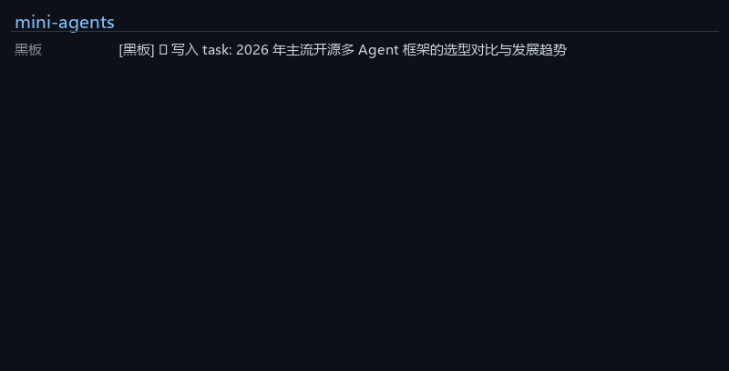

# mini-agents

<!-- 发布后取消注释（换成你的用户名）：[](https://github.com/你的用户名/mini-agents/actions/workflows/ci.yml) -->

**从零手写的多 Agent 协作框架**——不依赖任何 agent 框架，约 700 行核心 Python，
把多 Agent 协作的每个机制亲手实现一遍：自主循环、并行工具调度、编排委派、
共享黑板、批评循环、MCP 协议接入，外加一套一条命令可复现的评测 harness。

> 为什么从零写？因为"调用框架"和"理解框架"是两回事。
> 所有设计取舍都记录在 [DECISIONS.md](DECISIONS.md)，学习路径见 [docs/LEARNING.md](docs/LEARNING.md)。

## 功能一览

- **Agent 自主循环**：请求模型 → 执行它要的工具 → 结果回填 → 再请求，直到任务完成
- **并行工具调度**：模型一条消息发出的多个工具调用由 `asyncio.gather` 并发执行
- **delegate 编排**：把"派子 Agent"做成一个工具，模型可自主拆解并并行委派子任务
- **共享黑板**：Agent 之间用结构化数据交换产出，可持久化、可回放，不靠自由聊天
- **批评循环**：Reviewer 输出 JSON 结论，不通过就带着问题清单打回重写（带轮数上限）
- **断点恢复**：黑板即检查点，每阶段落盘；崩溃后 `--resume` 幂等续跑，已完成阶段零重复消耗
- **多模型成本路由**：per-agent 模型配置——调研员走便宜模型，规划/写作保留强模型
- **本地 RAG**：BM25 知识库工具（jieba 中文分词，带来源检索），纯本地零 API 成本
- **手写 MCP 客户端**：纯标准库实现 stdio + JSON-RPC 2.0，任意 MCP server 的工具
  动态接入，与本地工具无差别使用
- **评测 harness**：18 个可程序化判分任务 × 4 组编排策略对照实验，产出成功率 /
  token 成本 / 时延 / 并行加速比
- **全程 trace**：每个 Agent 的每次请求、每次工具调用都落 JSONL，可实时观看、可回放

## 架构

```
                 ┌─────────────────────────────────────────────┐
                 │      demo / app.py（命令行 & Streamlit）      │
                 └──────┬───────────────┬────────────────┬─────┘
              阶段1     │          阶段2 │           阶段3 │
                  ┌─────▼─────┐   ┌─────▼─────┐    ┌─────▼──────┐
                  │  Planner  │   │  Writer   │───►│  Reviewer  │
                  │ 拆解+派活  │   │ 汇总成稿  │◄───│ 审查打回    │
                  └─────┬─────┘   └─────▲─────┘    └────────────┘
        research()/delegate()│ 并发   │ 读黑板
          ┌──────────────────┼──────┐ │
     ┌────▼────┐        ┌────▼────┐ ┌▼────────┐
     │子Agent 1 │        │子Agent 2 │ │子Agent N │   ← 每个都是全新 Agent，上下文隔离
     └────┬────┘        └────┬────┘ └────┬────┘
          └──────────────────┼───────────┘
                工具层（web_search / calculator / MCP 远程工具）
```

| 模块 | 职责 |
|---|---|
| `mini_agents/llm.py` | OpenAI 兼容接口薄封装（智谱 GLM / Z.ai / OpenAI …） |
| `mini_agents/agent.py` | Agent 自主循环 + 并行工具执行 |
| `mini_agents/tools.py` | 工具注册（签名 → JSON Schema）+ 内置工具 |
| `mini_agents/mcp_client.py` | 手写 MCP 客户端（stdio + JSON-RPC 2.0） |
| `mini_agents/delegation.py` | delegate 工具（模型自主多 Agent 编排） |
| `mini_agents/blackboard.py` | 共享黑板 |
| `mini_agents/tracing.py` | JSONL trace + 终端实时摘要 |
| `evals/` | 评测任务集与 runner |

## 演示

**深度调研小组**（Planner → 并行 Researcher → Writer ⇄ Reviewer）：

```bash
python demo_research_team.py "你想调研的问题"   # 命令行，实时打印协作过程
python demo_research_team.py --resume runs/<时间戳>   # 断点恢复（v1.2）
streamlit run app.py                            # 控制台（两页）：
#   🎯 深度调研小组 —— 实时协作时间线 + 报告 + Token 用量 + 断点恢复
#   📊 评测看板     —— 交互式跨框架对比（选框架/配置/指标、逐任务矩阵、失败明细）
python view_trace.py runs/<时间戳>/trace.jsonl   # 彩色回放任意一次协作
python demo_cost_routing.py "调研问题"          # 多模型成本路由（强模型规划+便宜模型调研）
python demo_rag.py "知识库问题"                 # BM25 本地知识库问答（v1.2）
```



**MCP 文件任务**（Agent 只靠 MCP 远程工具完成盘点汇总）：

```bash
python demo_mcp.py
```

## 评测

四组配置共享同一提示词与工具集、只切换执行器（串行 / 并行 / 编排 / 编排+审查），
18 个任务全部程序化判分：

```bash
python -m evals --offline   # 离线自检：免费验证评测管线与判分逻辑
python -m evals             # 真实评测（需 .env）
```

### 实测结果（2026-10-25，deepseek-v4.1-flash-1017 @ 共享限流网关，18 任务 × 4 配置，一次完整运行）

| 配置 | 成功率 | 平均耗时 | 平均 tokens | 平均请求数 |
|---|---|---|---|---|
| single（串行工具执行） | 94% | 33.3s | 1726 | 2.4 |
| single-parallel（并行工具执行） | 89% | 51.4s | 2051 | 2.6 |
| orchestrated（delegate 编排） | 89% | 49.8s | 1827 | 2.2 |
| orchestrated-review（+审查循环） | 94% | 55.2s | 3028 | 3.9 |

三个值得读的发现：

- **并行不是无条件正收益**。共享限流通道上，并发请求在同一瞬间触发 429 退避风暴，
  多工具调用任务上并行比串行慢（0.21x）；而离线测试证明机制本身正确
  （并发启动时间差 1ms）。**并行的收益取决于通道吞吐，不取决于代码写法**。
  为此框架层实现了 429 长退避重试（15/30/60/120s，尊重 Retry-After），
  本轮共触发 95 次，将受限流通道下的任务完成率从 11%（8/72）提升到 96%（69/72）。
- **审查循环的成本收益要分开看**。+75% tokens 换来的是同样的 94% 成功率——
  在强模型 + 可程序化判分的任务上没有可测收益；它的价值预期在弱模型与
  开放性任务上，待 LLM-as-judge 评测补充。
- **计数是 LLM 的真实短板**。唯一在三个配置同时失败的任务是"统计词频出现 9 次"
  （f4）——LLM 的计数弱点在多 Agent 编排下也未必能补救（仅 orchestrated 偶然通过）。

原始数据：`evals/results/1025-145610/`（results.jsonl / report.md / chart.png / 逐任务 trace），
`python -m evals` 一条命令可复现。

### 跨框架对比：mini-agents vs LangGraph vs OpenAI Agents SDK（v1.1）

同一任务集、同一提示词、同一工具与判分器、**同一编排架构**（delegate-as-tool），
仅框架不同。模型 deepseek-v4.1-flash @ 共享限流网关。
（原计划对比 CrewAI，但其全版本钉死 `Requires-Python <3.14`，经确认后换用
OpenAI Agents SDK，过程记录见 DECISIONS.md #15。）

| 指标 | mini-agents | LangGraph 1.2 | Agents SDK 0.24 |
|---|---|---|---|
| single 成功率 | 94%（17/18） | **100%**（18/18） | 94%（17/18） |
| orchestrated 成功率 | 89%（16/18） | **94%**（17/18） | **94%**（17/18） |
| single 平均 tokens | **1726** | 2453 | 1741 |
| orchestrated 平均 tokens | **1827** | 3242 | 2480 |
| **编排开销（orch/single tokens）** | **+6%** | +32% | +42% |
| single 平均耗时 * | 33.3s | 92.7s | **13.8s** |

核心发现：**三框架的成功率在同一水平线上（相差 1 个任务，且都是 f4 计数题——
那是模型短板不是框架差异），真正的分野在编排的 token 成本**：mini-agents 的
上下文隔离 + 黑板让"多 Agent"只多花 6% tokens；LangGraph 的 supervisor 把
worker 结果全部灌回主 Agent 上下文（+32%）；Agents SDK 的 delegate 回填 +42%。
架构选择直接兑换成真金白银的 token 账单。

如实注明：① 单次运行、样本 18，成功率差异属噪声级；② * 延迟不可直接对比——
限流对齐策略不同（mini 反应式退避 / LangGraph 主动 25s 限速 / Agents SDK 仅
SDK 重试），且运行时段不同、通道拥挤度不同；③ 三者 token 口径均为 API 返回
usage；④ LangGraph / Agents SDK 不暴露 agent 级串并行开关，故各跑
single + orchestrated 两配置（mini 四配置数据见上一节）。
- 三框架对比表可用 `python -m evals.compare` 自动重新生成（写入 evals/COMPARISON.md），
  每框架取任务数最多的最新全量运行。
数据：`evals/results/1025-145610/`、`evals/results/1025-231621-langgraph/`、
`evals/results/1026-003312-agents-sdk/`，`python -m evals --framework <名称>`
一条命令复现。

## 快速开始

```bash
pip install -r requirements.txt
copy .env.example .env        # 填入你的 API Key（默认智谱 bigmodel，可换任意兼容接口）

python test_offline.py        # 不花钱验证 agent 循环与并行调度
python test_mcp.py            # 不花钱验证 MCP 协议层
python test_checkpoint.py     # 不花钱验证断点恢复（崩溃 → 续跑 → 调用守恒）
python test_rag.py            # 不花钱验证 RAG 检索正确性
python test_cost_routing.py   # 不花钱验证多模型路由接线
python demo_research_team.py  # 跑第一个多 Agent demo
```

## 断点恢复（v1.2）

黑板即检查点：流水线每完成一个阶段就把 `blackboard.json` 落盘；重跑时黑板上
已有产出的阶段自动跳过——崩溃只损失当前阶段，不重复花钱。

```bash
python demo_research_team.py "调研问题"               # 正常跑（每阶段自动 checkpoint）
python demo_research_team.py --resume runs/<时间戳>   # 中途挂了？从断点继续
```

- 恢复是幂等的：已写入黑板的产出不会重算；`test_checkpoint.py` 离线验证了
  "崩溃 → 恢复 → 调用守恒（恢复调用数 = 完整跑 − 崩溃前）"
- 粒度是阶段级（Planner / 初稿 / 每轮审查修订），步级恢复留给生产级实现
- 与框架层的 429 长退避配合，构成"扛住限流 + 挂了能续"的两层韧性

## 项目文档

- [DECISIONS.md](DECISIONS.md)：12 条设计决策——每个"为什么这么设计"都有答案
- [docs/LEARNING.md](docs/LEARNING.md)：学习路径、踩坑点、进阶练习、常见问题

## Roadmap

- [x] RAG 工具：BM25 版已落地（`mini_agents/rag.py`）；embedding 混合检索留有接入口
- [x] 多模型成本路由：`research_pipeline(researcher_llm=...)` + 成本场景核算 demo
- [ ] 评测扩展 LLM-as-judge，覆盖开放性任务（也是成本路由"成功率"轴的前提）
- [ ] MCP Streamable HTTP 传输与鉴权
- [ ] Handoffs 流水线模式（与黑板模式做成本对比）
- [ ] 调研员搜索持续失败时的早停机制（实测：通道限流导致搜索反复失败时，
      模型会换关键词重试直至烧满 15 轮上限——需要循环层识别无效重试并提前止损）

## License

[MIT](LICENSE)
